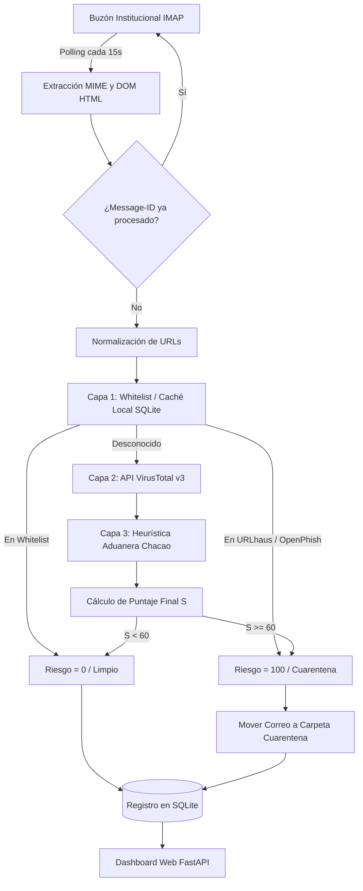
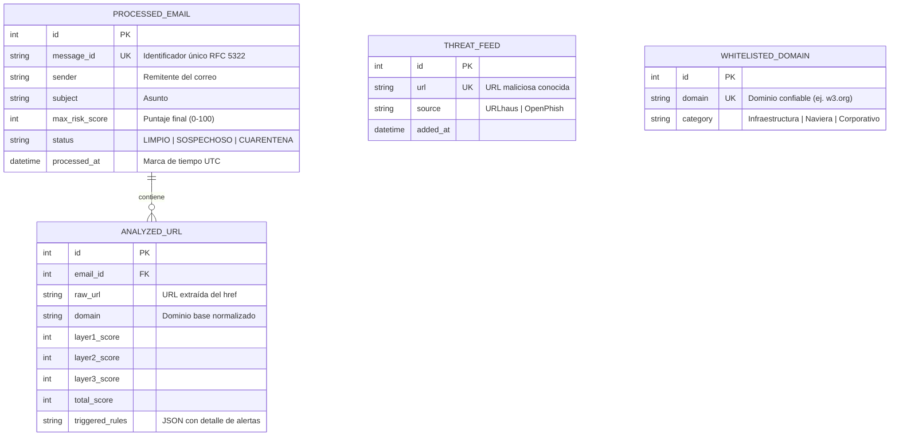

# 🏛️ Arquitectura Técnica y Modelo Teórico del Sistema

Este documento define las especificaciones técnicas, matemáticas y estructurales del **Sistema de Detección de Enlaces Maliciosos en Plataformas de Correo Institucional** aplicado al sector de importación y exportación del municipio Chacao.

---

## 1. Paradigma Arquitectónico (ICES)

El sistema implementa una arquitectura de **Seguridad de Correo Integrada en la Nube (ICES — *Integrated Cloud Email Security*)** bajo un modelo de protección posterior a la entrega (*Post-Delivery Protection*).

A diferencia de los *Secure Email Gateways* (SEG) tradicionales que requieren modificar registros MX y actuar como *proxy* SMTP, este diseño opera mediante conexión directa al buzón institucional vía protocolo **IMAP sobre SSL/TLS (puerto 993)**, ejecutando un análisis híbrido en tres capas y aplicando remediación automatizada mediante el traslado de mensajes a una carpeta de aislamiento (`Cuarentena`).

---

## 2. Flujo de Procesamiento (Pipeline)

---

## 3. Modelo Matemático de Puntuación de Riesgo (*Risk Scoring*)

Cada enlace extraído $u_i$ dentro de un correo electrónico es evaluado en una escala normalizada de $[0, 100]$ puntos. El puntaje final de riesgo del correo $S_{\text{correo}}$ corresponde al **valor máximo** obtenido entre todos los enlaces contenidos en el mensaje:

$$S_{\text{correo}} = \max_{i} \left( \min \left( 100, \; S_{\text{C1}}(u_i) + S_{\text{C2}}(u_i) + S_{\text{C3}}(u_i) \right) \right)$$

### Umbrales de Decisión
* **$0 \le S_{\text{correo}} < 30$ (Limpio):** El mensaje permanece en la bandeja de entrada (`INBOX`).
* **$30 \le S_{\text{correo}} < 60$ (Sospechoso / Advertencia):** El mensaje permanece en `INBOX`, pero se genera una alerta preventiva de nivel medio en el Dashboard.
* **$S_{\text{correo}} \ge 60$ (Malicioso / Crítico):** El sistema ejecuta la remediación automática, moviendo el mensaje a la carpeta `Cuarentena` y registrando el incidente de alta severidad.

---

### Detalle de Ponderación por Capas

#### Capa 1: Control Local y Feeds de Amenazas ($S_{\text{C1}}$)
Operación de latencia mínima ($< 5\text{ ms}$) ejecutada localmente en SQLite:
* **Coincidencia en Lista Blanca Corporativa (`WhitelistedDomain`):** Cortocircuito inmediato; asigna $S = 0$ y omite las capas 2 y 3 (evita falsos positivos y ahorra cuota de API).
* **Coincidencia en Lista Negra Local (`ThreatFeed` — URLhaus/OpenPhish):** Cortocircuito inmediato; asigna $S_{\text{C1}} = 100$.

#### Capa 2: Inteligencia de Amenazas Externa ($S_{\text{C2}}$)
Consulta a la API REST v3 de **VirusTotal** (con caché temporal de 24 horas y cola de control de tasa de $\le 4\text{ req/min}$):
* **Motores que reportan `malicious` ($M$):** $+35\text{ puntos}$ por cada motor ($M \times 35$). Con $M \ge 2$, el enlace alcanza automáticamente $\ge 70\text{ puntos}$.
* **Motores que reportan `suspicious` ($P$):** $+15\text{ puntos}$ por cada motor ($P \times 15$).

#### Capa 3: Heurística Contextual de Comercio Exterior ($S_{\text{C3}}$)
Reglas determinísticas diseñadas específicamente para el contexto operativo de empresas de importación y exportación en Chacao:

| Regla Heurística | Condición Técnica | Puntos | Justificación en el Sector |
| :--- | :--- | :---: | :--- |
| **H1: Suplantación de Marca (*Typosquatting*)** | Distancia de Levenshtein $d \in \{1, 2\}$ respecto a dominios legítimos de navieras, couriers y entes aduaneros (`maersk.com`, `msc.com`, `dhl.com`, `fedex.com`, `seniat.gob.ve`, `bolipuertos.gob.ve`). | **+50** | Ataques dirigidos imitando portales de rastreo (*tracking*) o pago de aranceles. |
| **H2: Discrepancia de Hipervínculo** | El texto visible del enlace aparenta ser una URL (`https://...`), pero el dominio en el atributo `href` difiere del dominio visible. | **+45** | Técnica clásica de ocultamiento de destino en notificaciones de facturación. |
| **H3: Dirección IP Directa** | El host de la URL es una dirección IPv4/IPv6 literal en lugar de un nombre de dominio registrado (ej. `http://192.168.1.50/factura`). | **+40** | Infraestructura efímera o servidores comprometidos sin reputación DNS. |
| **H4: Uso de Acortadores de URL** | El dominio pertenece a servicios de redirección (`bit.ly`, `tinyurl.com`, `t.co`, `cutt.ly`, `is.gd`). | **+20** | Ocultamiento del destino real en notificaciones rápidas de despacho. |
| **H5: Ingeniería Social Aduanera** | Presencia de términos críticos de urgencia logística en el asunto o cuerpo (*"guía retenida"*, *"manifiesto de carga"*, *"BL pendiente"*, *"pago de arancel"*, *"liberación de contenedor"*, *"swift"*). | **+15** | Contextualiza el riesgo cuando se combina con anomalías estructurales. |

---

## 4. Modelo de Datos (SQLite)

El almacenamiento persistente se gestiona mediante cuatro entidades principales en `app/db/models.py`:

---

## 5. Estrategia de Concurrencia y Resiliencia

1. **Ciclo de Vida Unificado (`lifespan`):** El servidor web **FastAPI** gestiona un hilo/tarea asíncrona en segundo plano (`asyncio.create_task`) que ejecuta el sondeo IMAP sin bloquear las peticiones HTTP del Dashboard.
2. **Idempotencia:** Antes de analizar un correo, el monitor consulta su cabecera `Message-ID` en la tabla `PROCESSED_EMAIL`. Si ya existe, el mensaje se omite, evitando bucles infinitos o consumo redundante de API.
3. **Gestión de Cuota de VirusTotal:** Se implementa un limitador de frecuencia (*Token Bucket* o retraso controlado de $15.5\text{ segundos}$ entre consultas externas) junto con una caché en memoria/SQLite para no exceder el límite de $4\text{ peticiones/minuto}$ del nivel gratuito.

---

## 6. Protocolo de Validación y Pruebas Controladas

Para garantizar la seguridad del entorno universitario durante las pruebas y la defensa ante el jurado:
* **Prohibición de Ejecución Activa:** Ningún módulo del sistema realiza peticiones `GET` ni descarga contenido de los enlaces analizados; el análisis es estrictamente estático y reputacional.
* **Escenarios de Prueba Seguros:** Se utilizarán dominios de prueba inofensivos configurados localmente en la tabla `THREAT_FEED` (ej. `http://test-phishing-aduanas.local/guia`) y plantillas de correo simuladas que disparen las reglas heurísticas `H1`–`H5` sin exponer la red local a amenazas reales.