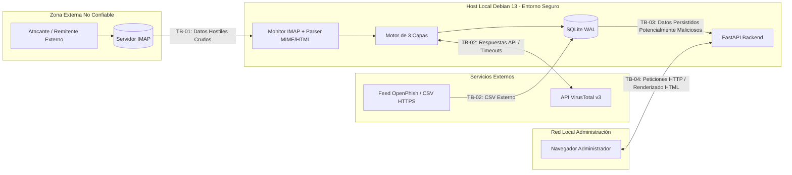

# 🛡️ Modelado de Amenazas (Threat Modeling — SSDLC)

Este documento establece el análisis formal de seguridad previo a la codificación del **Sistema de Detección de Enlaces Maliciosos en Plataformas de Correo Institucional**, alineado con los marcos **OWASP SAMM**, **NIST SSDF (SP 800-218)**, **OWASP Top 10** y **OWASP ASVS v4.0**.

Dado que el sistema procesa activamente entradas hostiles diseñadas por adversarios (correos de *phishing*, estructuras MIME adulteradas y URLs maliciosas), todo dato proveniente del buzón IMAP se clasifica como **entrada no confiable (*Untrusted Input*)**.

---

## 1. Activos Críticos a Proteger (*Assets*)

| ID | Activo | Descripción | Impacto en caso de compromiso |
| :--- | :--- | :--- | :--- |
| **ACT-01** | Credenciales y Secretos | Contraseña de aplicación IMAP y clave de API de VirusTotal en `.env`. | Acceso total al buzón institucional o suplantación/agotamiento de la cuota de API externa. |
| **ACT-02** | Integridad del Buzón | Mensajes legítimos y carpeta `Cuarentena` en el servidor de correo. | Pérdida de comunicaciones críticas de comercio exterior o evasión de enlaces maliciosos hacia el usuario final. |
| **ACT-03** | Consola Web (Dashboard) | Navegador y sesión del administrador que audita incidentes. | Ejecución de JavaScript arbitrario (*Blind Stored XSS*) al visualizar asuntos o URLs maliciosas registradas. |
| **ACT-04** | Disponibilidad del Motor | Proceso Python (FastAPI + Worker IMAP) en Debian 13 y cuota de API externa. | Paralización del monitoreo (*Denial of Service*) mediante correos bomba, expresiones regulares catastróficas o agotamiento de VirusTotal. |
| **ACT-05** | Base de Datos SQLite | Registros forenses en `phishguard.db`, listas blancas y *feeds* locales. | Manipulación de evidencia de incidentes, inyección SQL o corrupción por escrituras concurrentes. |

---

## 2. Fronteras de Confianza (*Trust Boundaries*)

* **TB-01 (Servidor IMAP $\rightarrow$ Parser):** Frontera de mayor exposición. Ingresan cabeceras RFC 5322, codificaciones rotas, árboles HTML profundos y URLs ofuscadas.
* **TB-02 (Motor $\leftrightarrow$ APIs Externas):** Riesgo de respuestas lentas (*hanging sockets*), errores `429 Too Many Requests` o archivos CSV sobredimensionados.
* **TB-03 (SQLite $\rightarrow$ FastAPI/Templates):** Datos originalmente hostiles almacenados en la base de datos que pasan a ser renderizados en vistas HTML.
* **TB-04 (Usuario $\rightarrow$ Analizador Manual):** Entrada HTTP POST directa que debe ser validada sintáctica y semánticamente.

---

## 3. Análisis de Amenazas bajo Metodología STRIDE

| Categoría STRIDE | Amenaza Identificada | Referencia OWASP / CWE | Mitigación Arquitectónica Obligatoria |
| :--- | :--- | :--- | :--- |
| **S — Spoofing** (Suplantación) | Ataques homográficos IDN usando alfabetos cirílicos/griegos (ej. `mаersk.com`) o falsificación de cabeceras `From` para simular dominios en lista blanca (`maersk.com.evil.ru`). | OWASP A07 / CWE-290 | Conversión obligatoria a **Punycode (`idna`)**; extracción estricta del host real; comparación de lista blanca únicamente por coincidencia exacta o subdominio jerárquico precedido por punto (`.dominio.com`). |
| **T — Tampering** (Manipulación) | **SQL Injection** a través de URLs/asuntos maliciosos o **IMAP Command Injection** mediante caracteres CRLF (`\r\n`) en UIDs o nombres de carpetas. | OWASP A03 / CWE-89 / CWE-93 | Consultas 100% parametrizadas sobre `sqlite3` nativo; validación numérica estricta (`isdigit()`) para UIDs IMAP; prohibición de interpolación directa de cadenas. |
| **R — Repudiation** (Repudio) | **Log Injection (CRLF)** donde un atacante incluye saltos de línea falsos en el asunto de un correo para adulterar los registros de auditoría del sistema. | OWASP A09 / CWE-117 | Función transversal de sanitización de logs que elimina `\r`, `\n` y caracteres de control antes de escribir cualquier evento; marcas de tiempo inmutables en UTC. |
| **I — Information Disclosure** (Fuga de Datos) | Exposición de `EMAIL_PASSWORD` o `VIRUSTOTAL_API_KEY` en trazas de error (*tracebacks*) o logs; o **SSRF** induciendo al servidor a hacer peticiones HTTP hacia redes internas (`127.0.0.1`, `192.168.x.x`). | OWASP A05 / A10 (SSRF) / CWE-200 / CWE-918 | Uso de clausuras léxicas (`make_secret`) para enmascarar secretos; manejadores globales de errores sin *stack traces* al cliente; **política de Cero Navegación Activa**: el motor jamás realiza peticiones HTTP hacia las URLs extraídas. |
| **D — Denial of Service** (Denegación de Servicio) | **ReDoS** por expresiones regulares con *backtracking* exponencial; correos gigantescos (*MIME Bombs*); o correos con decenas de enlaces para agotar las $4\text{ req/min}$ de VirusTotal. | OWASP API4 / CWE-1333 / CWE-400 | Tope de lectura por mensaje ($2\text{ MB}$ máx. de cuerpo analizable), longitud máxima de URL ($2048\text{ caracteres}$), deduplicación previa de enlaces, tope de consultas externas por correo y *timeouts* estrictos en sockets. |
| **E — Elevation of Privilege / XSS** | **Blind Stored XSS**: Inyección de `<script>` o esquemas `javascript:alert(1)` en asuntos o enlaces para comprometer el navegador del administrador en el Dashboard. | OWASP A03 (XSS) / CWE-79 / ASVS V5 | Auto-escapado HTML forzoso en `Jinja2`; cabeceras `Content-Security-Policy` (CSP) restrictivas; prohibición de renderizar URLs sospechosas como hipervínculos clicables activos (*URL defanging* o texto plano). |

---

## 4. Principios de Diseño Seguro Aplicados (*Security by Design*)

1. **Defensa en Profundidad (*Defense in Depth*):** Si la API de VirusTotal falla o no posee firmas para un ataque *zero-day* dirigido a una importadora en Chacao, la Capa 3 (Heurística Aduanera + *Typosquatting*) actúa como red de contención independiente.
2. **Fallo Seguro (*Fail-Safe Defaults*):** Ante errores de red, codificaciones ilegibles o caídas de servicios externos, el sistema captura la excepción de forma controlada, conserva la estabilidad del proceso y evalúa el correo con la evidencia local disponible sin detener el monitoreo.
3. **Mínimo Privilegio (*Least Privilege*):** La aplicación se ejecuta con un usuario estándar sin privilegios `root` en Debian 13, utiliza una contraseña de aplicación revocable para el buzón y abre únicamente conexiones salientes HTTPS/IMAPS (puertos $443$ y $993$).